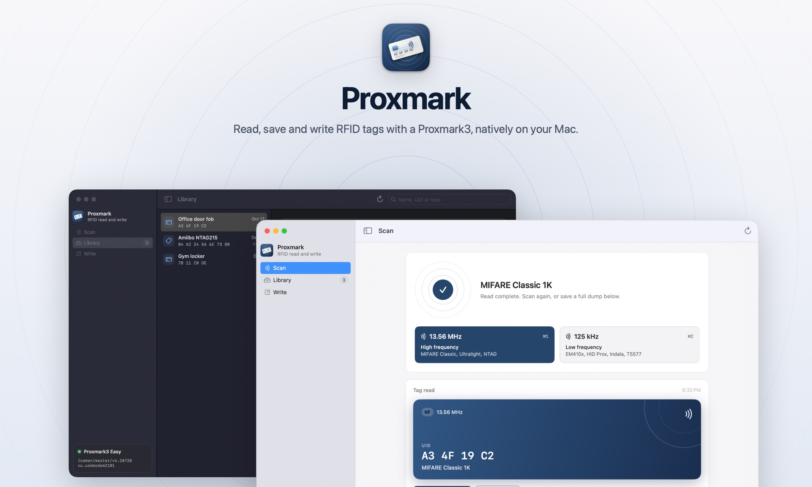
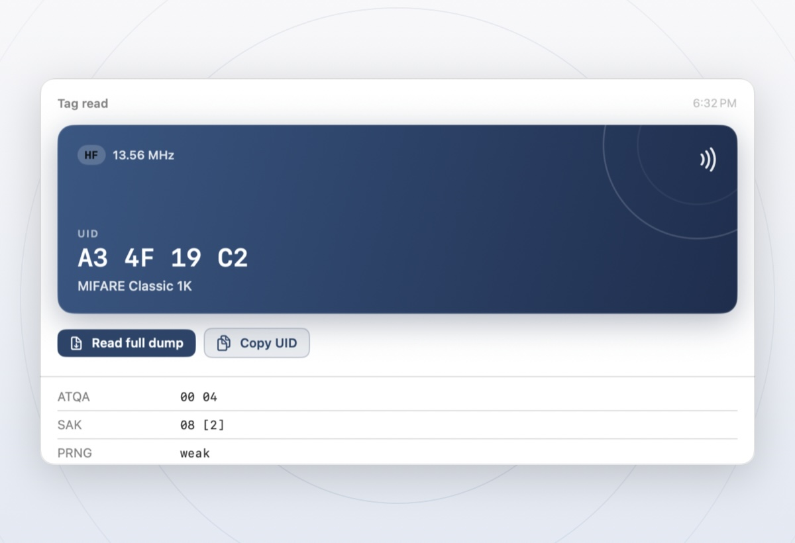
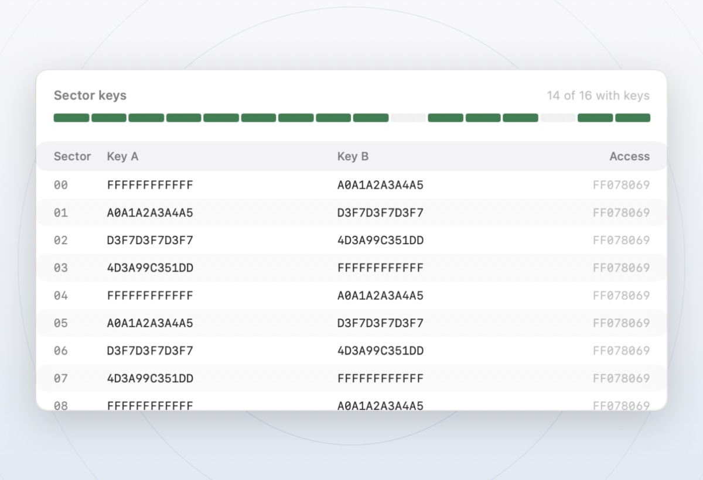
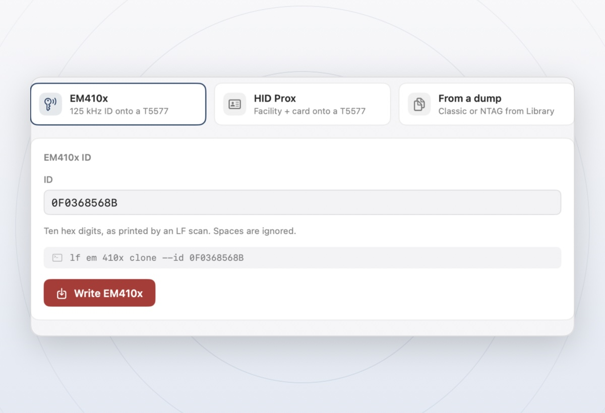
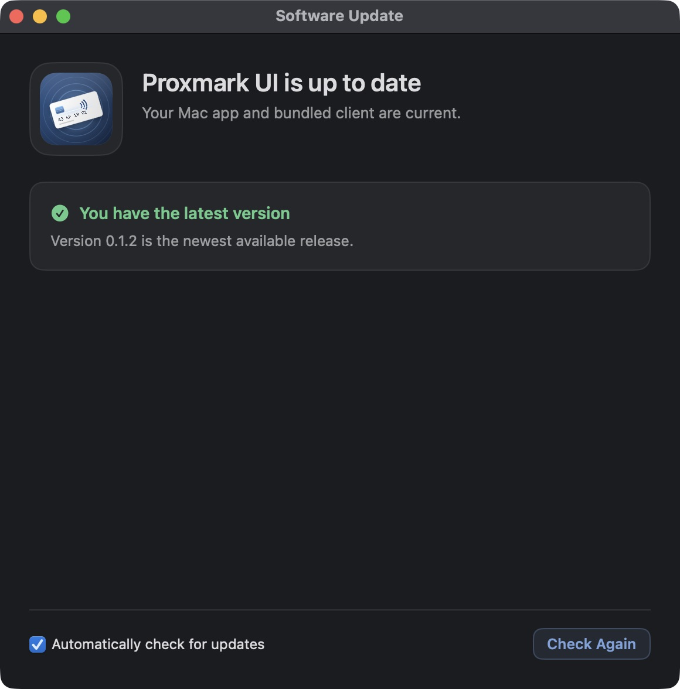

<p align="center">
  <picture>
    <source media="(prefers-color-scheme: dark)" srcset="docs/images/hero-dark.jpg">
    
  </picture>
</p>

<p align="center">
  <a href="https://github.com/claudfuen/proxmark-ui/releases"><b>Download for Apple silicon</b></a>
  &nbsp;·&nbsp;
  <a href="#build-from-source">Build from source</a>
  &nbsp;·&nbsp;
  <a href="#troubleshooting">Troubleshooting</a>
</p>

<p align="center">
  
  
  
  
</p>

Proxmark is a native Mac app for the everyday Proxmark3 jobs: scan a tag, see what it is, save a full dump, and write to a compatible blank. It drives the [Iceman client](https://github.com/RfidResearchGroup/proxmark3) underneath and keeps its raw output one click away, so nothing is hidden. The client ships inside the app, so there's no Homebrew, no separate install and no command line.

> [!IMPORTANT]
> Only read or write tags and systems you own or are authorized to test. Writing permanently changes the tag on the antenna.

## What it does

<table>
  <tr>
    <td width="33%" valign="top">
      <picture>
        <source media="(prefers-color-scheme: dark)" srcset="docs/images/feature-scan-dark.jpg">
        
      </picture>
      <h3>Scan</h3>
      Search 13.56 MHz or 125 kHz with one click or <kbd>⌘1</kbd> / <kbd>⌘2</kbd>. The tag comes back as a card with its type and UID, plus every detail the client reported.
    </td>
    <td width="33%" valign="top">
      <picture>
        <source media="(prefers-color-scheme: dark)" srcset="docs/images/feature-library-dark.jpg">
        
      </picture>
      <h3>Library</h3>
      Save full dumps of MIFARE Classic and Ultralight/NTAG tags. Inspect key bytes by sector, read the raw memory in a hex view, and reveal the files in Finder.
    </td>
    <td width="33%" valign="top">
      <picture>
        <source media="(prefers-color-scheme: dark)" srcset="docs/images/feature-write-dark.jpg">
        
      </picture>
      <h3>Write</h3>
      Program an EM410x ID or HID H10301 number onto a T5577, or restore a saved dump. Fields are checked as you type, and you see the exact command before confirming.
    </td>
  </tr>
</table>

<details>
<summary><b>See every screen in light and dark</b></summary>

| | Light | Dark |
| --- | --- | --- |
| **Scan** |  |  |
| **Library** |  |  |
| **Write** |  |  |

</details>

**Also in the box**

- **Connection help that tells you the fix.** Missing client, unplugged reader, a busy port or mismatched firmware each get a plain explanation and a button that resolves it.
- **Firmware updates for Proxmark3 Easy and RDV4**, with a required check of your exact model before anything is written. [More below](#hardware-and-firmware).
- **Built for the Mac.** SwiftUI throughout, light and dark mode, keyboard shortcuts, a Settings window, and a live clock on long reads so a multi-minute key recovery never looks frozen.
- **Hot-plug aware.** The app notices when a reader appears or disappears over USB and reconnects on its own.
- **A library you can use.** Save scanned EM410x and HID identities with names, then select a saved tag or dump from the Write screen. Identity writes read the tag back and report whether the result matches.
- **Mac app updates in the app.** A daily check and a **Check for Updates…** menu item keep the app and its bundled client current.

## Get started

You need a Mac with Apple silicon running macOS 13 or later, a Proxmark3 supported by the Iceman client, and a tag you're allowed to test.

1. **Download** the latest app ZIP from [Releases](https://github.com/claudfuen/proxmark-ui/releases), or [build it from source](#build-from-source). Each release includes a SHA-256 checksum file and the corresponding source.
2. **Open it.** Move `ProxmarkUI.app` to Applications if you like. Early builds are ad hoc signed and not notarized, so if macOS blocks the first launch, try once, then choose **Open Anyway** in **System Settings > Privacy & Security**.
3. **Plug in your Proxmark3.** The app finds the serial port and checks the firmware. Pick a band in Scan and hold a tag to the antenna.

Advanced users can choose **Reader > Locate Client…** to run a different Iceman build. The choice is saved on this Mac and takes priority over the bundled client.

### Keep the Mac app up to date

The app checks GitHub releases once a day by default and offers a one-time update prompt when a newer version is available. Choose **Proxmark > Check for Updates…** at any time to check manually or turn automatic checks off. **Download and Install** verifies the release ZIP, prepares the new app, and reopens it after replacing the installed copy. The previous copy is kept as a backup, and a failed launch restores it. Install the app in a writable location such as `~/Applications` for in-app installation. Versions before 0.1.2 need one manual download from [Releases](https://github.com/claudfuen/proxmark-ui/releases) before they gain this feature.



Mac app updates include the matching Iceman client and firmware images. They do not flash the connected reader. Current releases are ad hoc signed and not notarized. GitHub's SHA-256 digest and the code signature check detect damaged or altered downloads, but they do not independently prove publisher identity. macOS may require **Open Anyway** when the updated app launches.

### Keyboard shortcuts

| Action | Shortcut |
| --- | --- |
| Scan 13.56 MHz | <kbd>⌘</kbd> <kbd>1</kbd> |
| Scan 125 kHz | <kbd>⌘</kbd> <kbd>2</kbd> |
| Reconnect the reader | <kbd>⌘</kbd> <kbd>R</kbd> |
| Settings | <kbd>⌘</kbd> <kbd>,</kbd> |

## Hardware and firmware

The Iceman client and the firmware on your reader must speak the same protocol version. If they don't, the app shows **Firmware and client don't match** and blocks scans. For example, a reader on protocol v6 can't scan with a client that speaks v13.

The app bundles two full firmware images, built from the same Iceman checkout as its client:

| Model | Image | Notes |
| --- | --- | --- |
| **Proxmark3 Easy** | `PM3GENERIC` build with Easy LED order | Fits 256 KB readers. Keeps the LF and ISO 14443-A support this app uses, and leaves out some advanced protocols and standalone modes, such as iCLASS, ISO 15693 and FeliCa. |
| **Proxmark3 RDV4** | `PM3RDV4` build | Full image for RDV4 hardware only. |

Choose **Update firmware** from the banner or the **Reader** menu. While the protocols differ the client can't read the model, and an Easy and an RDV4 look identical over USB. So the app asks which reader you have, unless it already learned the model from a previous connection with matching firmware. A generic firmware label is not taken as proof of an Easy. The app never touches the bootloader.

| Confirm the reader model | Follow the update |
| --- | --- |
|  |  |

> [!WARNING]
> Flashing can make a reader unresponsive. Choose the image for your exact hardware and keep the USB cable connected until the update finishes. If the reader doesn't enter flash mode on its own, the app explains how to reconnect it while holding its button. The update flow is implemented and packaged, but hasn't yet been tested by flashing physical hardware.

Need iCLASS or another protocol the Easy image leaves out? Build custom firmware with Iceman's [advanced compilation guide](https://github.com/RfidResearchGroup/proxmark3/blob/master/doc/md/Use_of_Proxmark/4_Advanced-compilation-parameters.md). For a model not listed here, follow the [Iceman build instructions](https://github.com/RfidResearchGroup/proxmark3#how-to-build) for that model, or choose a client that matches the firmware you already have. The in-app updater only works with the bundled client.

### What a scan can and can't tell you

Finding a tag doesn't mean it can be fully read or copied. Protected tags may need keys, or use features this app doesn't expose.

- **MIFARE Classic restore** authenticates with the saved keys or factory default keys, and needs the saved key file. A key file from an incomplete read can hold missing or placeholder keys, so it doesn't guarantee every sector restores. Library shows the key bytes saved for each sector; only authenticating against the tag proves they work.
- **Gen1a magic tags** can take a full Classic dump, including the UID.
- **Ultralight/NTAG restore** writes the supported data pages and leaves the UID and protected configuration pages alone.

## Build from source

The Swift package has no third-party Swift dependencies. Building the distributable app also needs Xcode Command Line Tools, a local build of the [Iceman fork](https://github.com/RfidResearchGroup/proxmark3) (see its [macOS setup guide](https://github.com/RfidResearchGroup/proxmark3/blob/master/doc/md/Installation_Instructions/macOS-Compile-From-Source-Instructions.md)), and a complete Arm GNU Toolchain with standard C headers, for example `brew install --cask gcc-arm-embedded`.

```sh
git clone https://github.com/RfidResearchGroup/proxmark3.git ~/Repos/proxmark3
make -C ~/Repos/proxmark3 client

cd /path/to/proxmark-ui
swift test
PM3_SRC=~/Repos/proxmark3 ./scripts/make-app.sh
open dist/ProxmarkUI.app
```

`swift build` gives you a development executable. `scripts/make-app.sh` builds a release app in `dist/ProxmarkUI.app` with the Iceman client, its dynamic libraries, dictionaries, scripts and resources, and the Easy and RDV4 firmware images. It builds each image from `PM3_SRC` (default `~/Repos/_vendor/proxmark3`), checks the client and images against that source revision, verifies the Easy package fits 256 KB, and never bundles a bootloader. The current public ZIP is ad hoc signed and may require a manual first-launch allowance on some Macs. Developer ID signing and notarization would provide reliable publisher verification for future releases.

The [release workflow](.github/workflows/macos-release.yml) runs the tests, builds Iceman at pinned revision `693ead08038c6ade43833579306e98eb3dd18d8e`, packages and verifies the app, and attaches the source and checksums to versioned releases. [`scripts/package-release.sh`](scripts/package-release.sh) produces the same assets locally.

<details>
<summary><b>Developing without a reader</b></summary>

Launch with `PMUI_DEMO=1` to load sample tags and dumps. Demo mode never sends commands to a reader or writes to a tag.

| Variable | Values | Effect |
| --- | --- | --- |
| `PMUI_DEMO` | `1`, `checking`, `noclient`, `nodevice`, `mismatch`, `empty`, `busy` | Seeds sample data, optionally in a given connection state |
| `PMUI_SECTION` | `scan`, `library`, `write` | Opens on that screen |
| `PMUI_APPEARANCE` | `light`, `dark` | Forces the appearance, for screenshots |
| `PMUI_HEX` | any | Opens the Library hex view expanded |
| `PMUI_WRITE_ID` | ten hex digits | Prefills the EM410x field in Write |

</details>

## How it works

```text
Proxmark (SwiftUI)
    │  reader state, scan and write flows, dump library
    ▼
ProxmarkKit (Swift)
    │  command validation, process runner, output parsing
    ▼
Iceman proxmark3 client  (bundled in the app)
    │  USB serial
    ▼
Proxmark3 reader
```

`ProxmarkKit` starts a fresh Iceman client process for each batch of commands, with a timeout, so a stuck reader can never wedge the app. Every value is validated before it reaches the client's command line. Saved dumps and their metadata live in `~/.proxmark3/ui/dumps`; saved identity tags live in `~/.proxmark3/ui/saved-tags`. Scan history covers the current session, while saved Library entries persist across launches. Anything the app doesn't expose is still available in the full Iceman CLI.

## Troubleshooting

| What you see | What to do |
| --- | --- |
| **No reader** | Connect the Proxmark3 over USB with a cable that carries data, ideally straight into the Mac. The app reconnects as soon as the port appears. |
| **The reader isn't answering** | Quit any other Proxmark3 client that may hold the port, reconnect the cable, then press <kbd>⌘</kbd> <kbd>R</kbd>. |
| **Firmware and client don't match** | Update the firmware from the banner, or pick an Iceman client built for the firmware on your device. See [Hardware and firmware](#hardware-and-firmware). |
| **Proxmark3 client unavailable** | The app bundle should include it. If you're running the bare SwiftPM executable, choose **Reader > Locate Client…** or set `PM3_CLIENT` to the client's path. |
| **Tag not found** | Hold the tag still on the correct antenna, try the other band, and open **Client output** to see Iceman's own response. |
| **Full dump unavailable or incomplete** | Full reads cover MIFARE Classic and Ultralight/NTAG. Classic key recovery can take minutes and may not recover every key. |
| **macOS blocks the first launch** | Local and early builds aren't notarized. After checking where the app came from, allow it in **System Settings > Privacy & Security**. |

## Credits and licensing

The ProxmarkUI source is licensed under [GPL-3.0-or-later](LICENSE.txt). It builds on the [RfidResearchGroup Iceman fork of Proxmark3](https://github.com/RfidResearchGroup/proxmark3), which is also [GPL version 3 or later](https://github.com/RfidResearchGroup/proxmark3/blob/master/LICENSE.txt). The packaged app includes a copy of the Iceman client, so redistributing it requires the applicable GPL license, copyright notices, and the corresponding source or a compliant source offer. Bundled third-party libraries and data files may carry their own notice requirements; see [THIRD_PARTY_NOTICES.md](THIRD_PARTY_NOTICES.md).

Proxmark3 and the Iceman client are the work of their contributors. This is an independent interface, not an official Iceman project. Screenshots use the app's built-in sample data and don't show a read or flash of a physical device.
