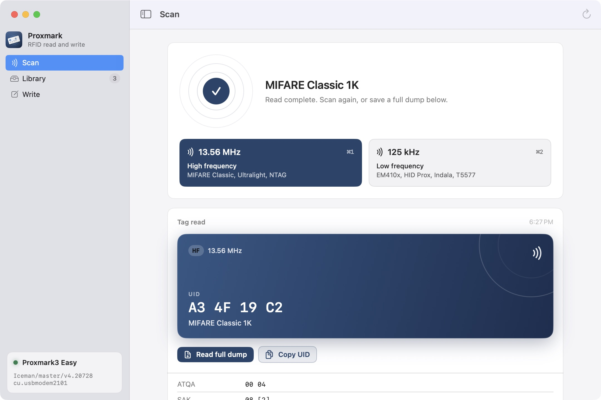
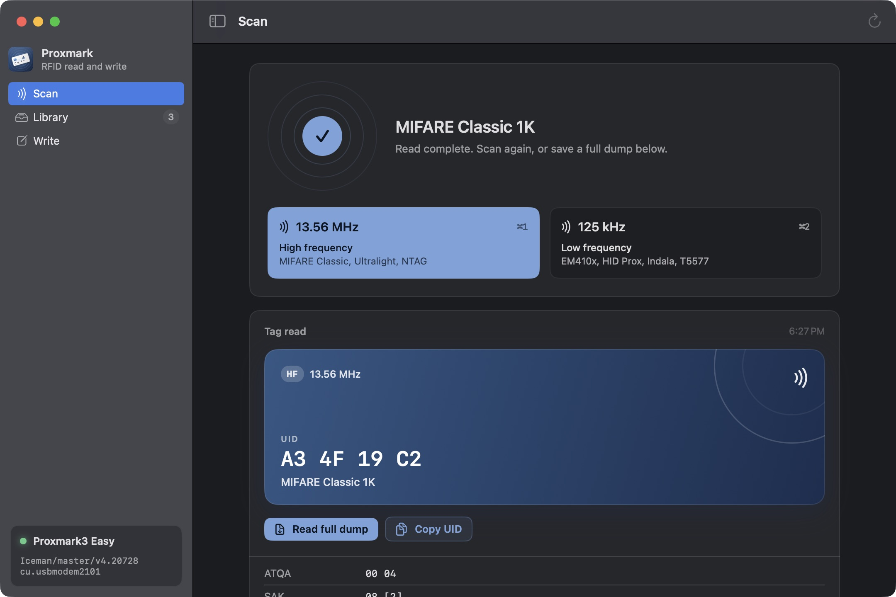
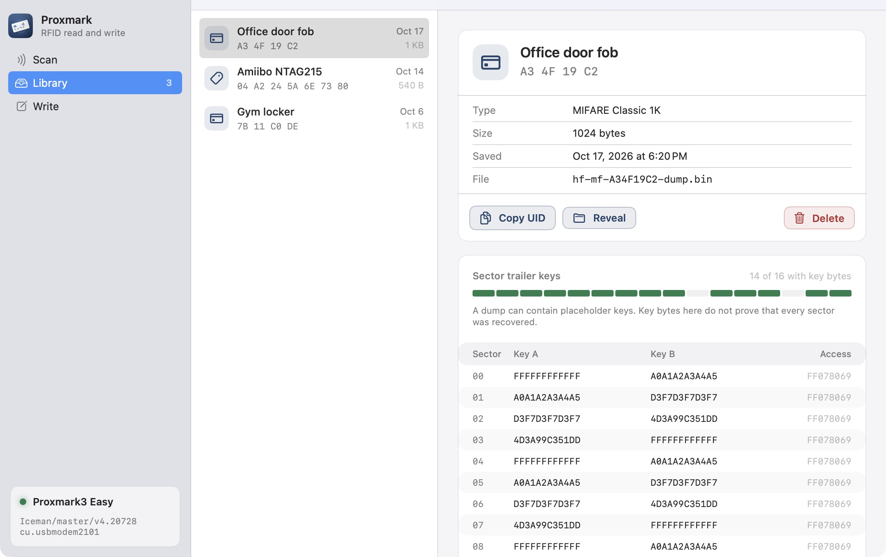
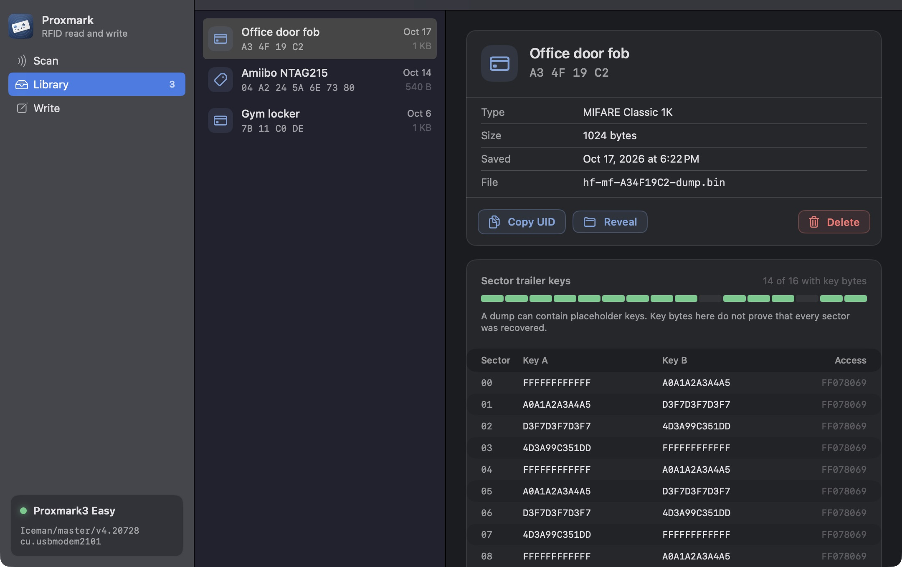
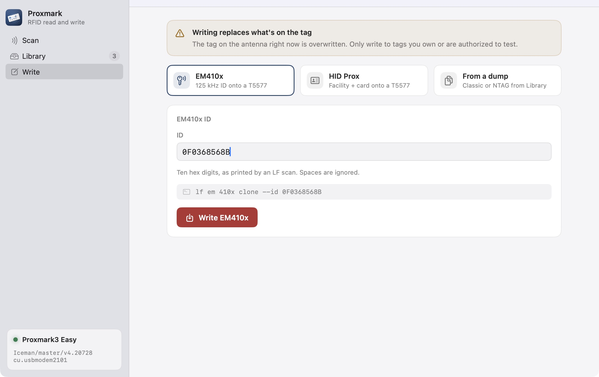
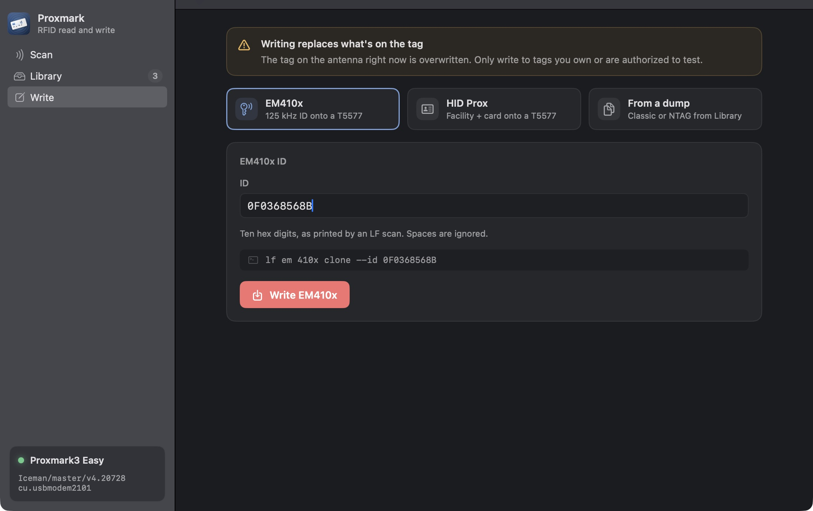
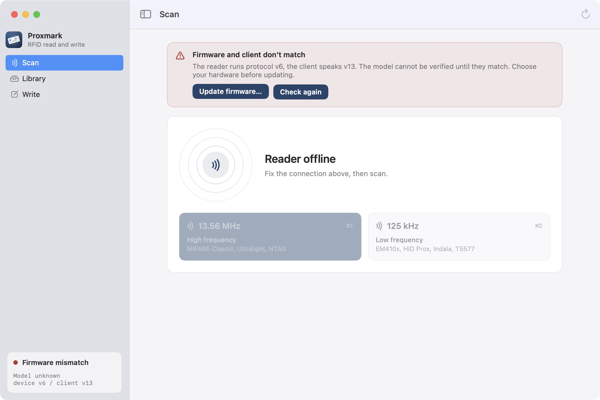
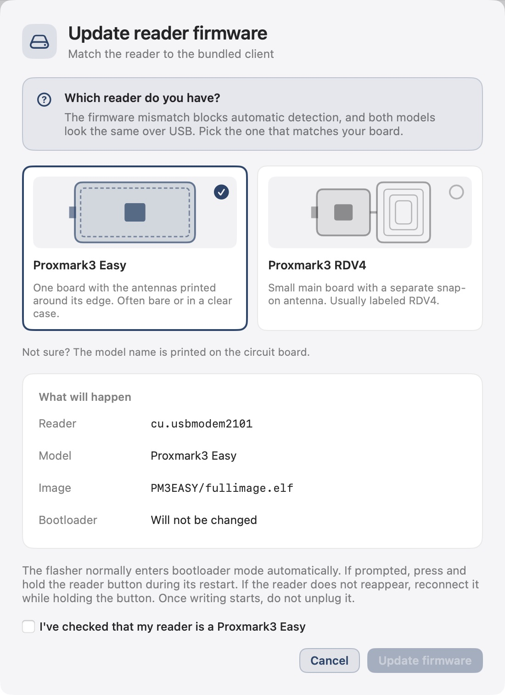
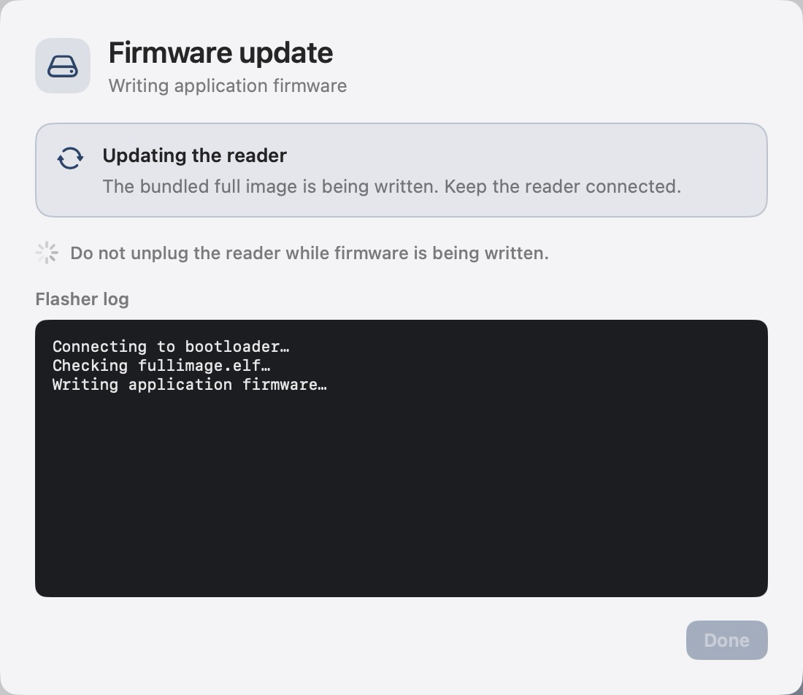

# ProxmarkUI

A native macOS workspace for scanning, saving, and writing RFID tags with a Proxmark3 and the [Iceman client](https://github.com/RfidResearchGroup/proxmark3).



ProxmarkUI makes the common Proxmark3 jobs approachable without hiding the client output. Scan at 13.56 MHz or 125 kHz, inspect a result, save a full dump when the tag supports it, and write to a compatible tag with a confirmation step. The packaged app includes the Iceman client and its data files, so using the app does not require Homebrew, a separate client installation, or a command line.

> The screenshots show the running macOS app with seeded example tag data. They do not imply a successful read or flash of a physical device.

## At a glance

| Scan | Library | Write |
| --- | --- | --- |
| Search both antenna bands, identify a tag, and inspect its UID and details. | Browse saved dumps, inspect MIFARE Classic sectors and saved key bytes, and reveal the files in Finder. | Program an EM410x ID or HID H10301 number onto a compatible T5577, or write from a saved Classic or Ultralight/NTAG dump. |

The app also detects when a Proxmark3 appears or disappears over USB, reports connection errors in context, and keeps the raw client log one click away. Input fields are validated before commands reach the client. Write actions ask for confirmation because they overwrite the tag on the antenna.

Finding a tag does not mean it can be fully read or copied. Protected tags can require keys or use features outside the flows exposed here.

Classic restore offers authentication with saved keys or factory default keys and requires the saved key file. A key file from an incomplete read can contain missing or placeholder keys, so it does not guarantee that every sector can be restored. Library displays saved key bytes by sector; authentication with the tag is needed to learn whether those keys work. A Gen1a magic tag can take a Classic dump including the UID. Ultralight/NTAG restore writes supported data pages and leaves the UID and protected configuration pages alone.

<details>
<summary>See the app in light and dark mode</summary>

| View | Light | Dark |
| --- | --- | --- |
| Scan |  |  |
| Library |  |  |
| Write |  |  |

</details>

## Start using it

You need a Mac running macOS 13 or later, a Proxmark3 connected by USB and supported by the Iceman client, and a tag you are authorized to test. The app bundle produced and tested here is for Apple silicon. An Intel build needs an Iceman client built for Intel and has not been verified.

1. Download the [Apple silicon v0.1.0 app ZIP](https://github.com/claudfuen/proxmark-ui/releases/download/v0.1.0/ProxmarkUI-v0.1.0-macos-arm64.zip), or [build the app bundle from source](#build-from-source). The release also provides a [SHA-256 checksum file](https://github.com/claudfuen/proxmark-ui/releases/download/v0.1.0/SHA256SUMS.txt) and corresponding source archives.
2. Extract the ZIP, move `ProxmarkUI.app` to Applications if you like, and open it. This first build is ad hoc signed and is not notarized. If macOS blocks it, attempt to open it once, then choose **Open Anyway** in **System Settings > Privacy & Security**.
3. Plug the Proxmark3 into USB. The app finds its serial port and checks the firmware. Choose **13.56 MHz** or **125 kHz** in Scan, or use **Command-1** and **Command-2**.

No separate Iceman installation is needed to run a packaged app. Advanced users can select **Reader > Locate Client…** to use a different client build. That choice is saved on this Mac and takes precedence over the bundled client.

## Hardware and firmware

The Iceman client and the reader's firmware must speak the same protocol version. A mismatch appears as **Firmware and client don't match** and prevents scans. For example, a reader on protocol v6 cannot scan with a client that speaks v13.



The packaging script includes two full firmware images built from the same Iceman checkout as the bundled client: **Proxmark3 Easy (256 KB or larger)** and **Proxmark3 RDV4**. Choose **Update Firmware** in the banner or **Reader** menu, then select and confirm your exact reader model before flashing. The app cannot identify the hardware model from a reader reporting the old protocol. A generic firmware label is not proof that the board is an Easy, so the app leaves the model unknown unless the reader provides a validated identity. Keep the USB cable connected while the app writes the image and checks the connection again. If the reader does not enter flash mode automatically, the app explains how to reconnect it while holding its button. The app never flashes the bootloader.

The update flow is implemented and packaged, but has not been tested by flashing physical hardware. The connected reader was left unchanged during this project.

| Confirm the reader model | Follow the update |
| --- | --- |
|  |  |

Flashing firmware always carries a risk of making a device unresponsive. Use an image built for your exact Proxmark3 hardware and flash capacity. Do not unplug it while a flash is in progress. The Easy image is a slim `PM3GENERIC` build with Easy LED ordering. It fits a 256 KB reader, keeps LF and ISO 14443-A support used by this app, and omits some advanced protocols and standalone modes. For example, it does not include iCLASS, ISO 15693, or FeliCa support. Build custom firmware using Iceman's [advanced compilation guide](https://github.com/RfidResearchGroup/proxmark3/blob/master/doc/md/Use_of_Proxmark/4_Advanced-compilation-parameters.md) if you need those features. If your model is not offered, follow the [Iceman firmware instructions](https://github.com/RfidResearchGroup/proxmark3#how-to-build) for that model or choose a client that matches the firmware already installed. The in-app updater requires the bundled client; a custom client needs firmware from its own build.

## Build from source

The Swift package has no third party Swift dependencies. Building the distributable `.app` requires Xcode Command Line Tools and a local build of the [Iceman fork](https://github.com/RfidResearchGroup/proxmark3). Follow Iceman's [macOS setup guide](https://github.com/RfidResearchGroup/proxmark3/blob/master/doc/md/Installation_Instructions/macOS-Compile-From-Source-Instructions.md) for client dependencies and install a complete Arm GNU Toolchain with standard C headers. On macOS, the [Homebrew `gcc-arm-embedded` cask](https://formulae.brew.sh/cask/gcc-arm-embedded) is one option: `brew install --cask gcc-arm-embedded`. The packaging script uses `~/Repos/_vendor/proxmark3` by default; set `PM3_SRC` if your checkout is elsewhere. It builds the Easy 256 KB and RDV4 images; other models need their own compatible firmware from Iceman.

```sh
git clone https://github.com/RfidResearchGroup/proxmark3.git ~/Repos/proxmark3
cd ~/Repos/proxmark3
make client
# The app packager rebuilds Easy and RDV4 full firmware images.

cd /path/to/your/proxmark-ui-checkout
swift test
swift build
PM3_SRC=~/Repos/proxmark3 ./scripts/make-app.sh
open dist/ProxmarkUI.app
```

`swift build` produces the executable for development. `scripts/make-app.sh` builds a release app in `dist/ProxmarkUI.app` and bundles the Iceman client, its required dynamic libraries, dictionaries, scripts, resources, and two full firmware images. It builds each image from `PM3_SRC`, checks the client and images against that source revision, and verifies that the Easy recovery package fits 256 KB. The script does not bundle a bootloader image. The output is ad hoc signed. Use a proper signing and notarization process before publishing a download intended to open without a Gatekeeper prompt.

The [Apple silicon build workflow](.github/workflows/macos-release.yml) runs tests, builds Iceman from pinned revision `693ead08038c6ade43833579306e98eb3dd18d8e`, packages and verifies the app, and attaches source and checksums to versioned releases. The [release script](scripts/package-release.sh) makes the same ZIP and corresponding source assets from a local build.

For UI development without a reader, launch with `PMUI_DEMO=1`. `PMUI_SECTION=scan|library|write` chooses the initial screen and `PMUI_APPEARANCE=light|dark` fixes the appearance for screenshots. Demo mode uses sample records; it does not write to a tag.

## How it works

```text
ProxmarkUI (SwiftUI)
    | reader state, scan and write flows, saved dump library
    v
ProxmarkKit (Swift)
    | command validation, process runner, output parsing
    v
Iceman proxmark3 client (bundled in the app)
    | USB serial connection
    v
Proxmark3 reader
```

`ProxmarkKit` starts a fresh Iceman client process for each command batch and applies a timeout, so the UI does not depend on a single persistent client session. The app stores saved dumps and their metadata under `~/.proxmark3/ui/dumps`. It keeps recent scan history for the current session; it is not a separate tag database. The full Iceman CLI remains available for commands that the UI does not expose.

## Troubleshooting

| What you see | What to check |
| --- | --- |
| **No reader** | Connect the Proxmark3 over USB. Try a cable that carries data and a direct port. The app watches for new USB modem ports and reconnects when one appears. |
| **Reader isn't answering** | Close another Proxmark3 client that may have the port open, reconnect the USB cable, then choose **Reader > Reconnect**. |
| **Firmware and client don't match** | Use the app's firmware update with the correct image, or select an Iceman client built to match the device. See [Hardware and firmware](#hardware-and-firmware). |
| **Client missing** | The app bundle should include the client. If you ran the bare SwiftPM executable, choose **Reader > Locate Client…** or set `PM3_CLIENT` to an executable path. |
| **Tag not found** | Keep the tag still on the correct antenna, try the other band, and expand **Client output** for the underlying Iceman response. |
| **Full dump unavailable or incomplete** | Full reads are wired up for MIFARE Classic and Ultralight/NTAG. Classic key recovery can take minutes and may not recover every key. |
| **macOS blocks first launch** | A locally built bundle is ad hoc signed and not notarized. Approve it from **System Settings > Privacy & Security** after verifying where it came from. |

## Use responsibly

Only read or write tags and systems you own or are authorized to test. Writing can permanently change a tag and may affect a system that relies on it. Check the card type and the tag on the antenna before confirming a write.

## Credits and licensing

The ProxmarkUI Swift source is licensed under [GPL-3.0-or-later](LICENSE.txt). ProxmarkUI uses the [RfidResearchGroup Iceman fork of Proxmark3](https://github.com/RfidResearchGroup/proxmark3). The Iceman source and client are also licensed under the [GNU GPL version 3 or later](https://github.com/RfidResearchGroup/proxmark3/blob/master/LICENSE.txt), as stated in its [README](https://github.com/RfidResearchGroup/proxmark3#copyright-and-licensing-terms). The packaged app carries a copy of the Iceman client; redistributing it requires the applicable GPL license, copyright notices, and corresponding source or a compliant source offer. Bundled third party libraries and data files may have additional notice requirements. See [THIRD_PARTY_NOTICES.md](THIRD_PARTY_NOTICES.md) and review those terms when producing a distributable build.

Proxmark3 and the Iceman client are the work of their respective contributors. ProxmarkUI is an independent interface and is not an official Iceman project.
